# ambientCG: More materials

**31 assets from [ambientCG](https://ambientcg.com), dedicated to the public domain under [CC0](https://docs.ambientcg.com/license/).** Use them in any game, free or paid, and change them however you like; no credit is needed.

PBR materials as 1K and 2K JPG maps (colour, normal GL and DX, roughness, AO, displacement), one folder per resolution. 897.3 MB in all.

This is a copy kept by [zuujis-cc0](https://github.com/zuujis-cc0) so game makers can take single files from GitHub. It is not made by or affiliated with ambientCG: the originals, often in more formats and higher resolutions, are on [ambientcg.com](https://ambientcg.com). If they help you, consider [supporting ambientCG](https://www.patreon.com/ambientCG).

Every file is listed in [MANIFEST.tsv](MANIFEST.tsv) with its size and SHA-256. More free assets: [the Zuujis collection](https://github.com/zuujis-cc0/free-game-assets#readme).

| | | | |
| :-: | :-: | :-: | :-: |
| <a href="Plaster004">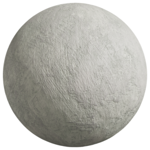</a> <b><a href="Plaster004">Plaster 004</a></b> by ambientCG · <a href="https://ambientcg.com/a/Plaster004">source</a> | <a href="Plaster005">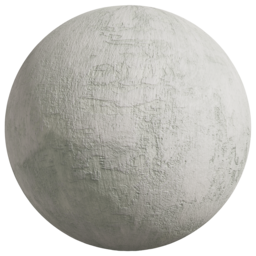</a> <b><a href="Plaster005">Plaster 005</a></b> by ambientCG · <a href="https://ambientcg.com/a/Plaster005">source</a> | <a href="Plaster006">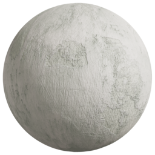</a> <b><a href="Plaster006">Plaster 006</a></b> by ambientCG · <a href="https://ambientcg.com/a/Plaster006">source</a> | <a href="Plaster007">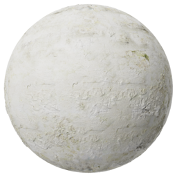</a> <b><a href="Plaster007">Plaster 007</a></b> by ambientCG · <a href="https://ambientcg.com/a/Plaster007">source</a> |
| <a href="Porcelain001">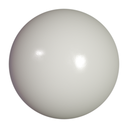</a> <b><a href="Porcelain001">Porcelain 001</a></b> by ambientCG · <a href="https://ambientcg.com/a/Porcelain001">source</a> | <a href="Porcelain002">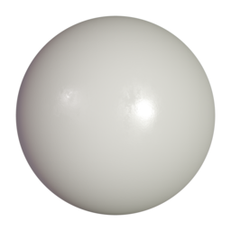</a> <b><a href="Porcelain002">Porcelain 002</a></b> by ambientCG · <a href="https://ambientcg.com/a/Porcelain002">source</a> | <a href="Porcelain003">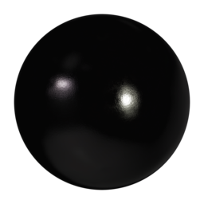</a> <b><a href="Porcelain003">Porcelain 003</a></b> by ambientCG · <a href="https://ambientcg.com/a/Porcelain003">source</a> | <a href="Rails001">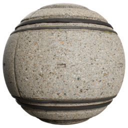</a> <b><a href="Rails001">Rails 001</a></b> by ambientCG · <a href="https://ambientcg.com/a/Rails001">source</a> |
| <a href="Rope001">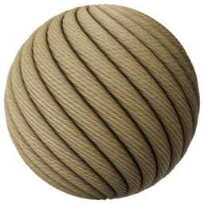</a> <b><a href="Rope001">Rope 001</a></b> by ambientCG · <a href="https://ambientcg.com/a/Rope001">source</a> | <a href="Rope002">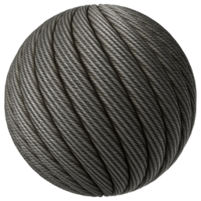</a> <b><a href="Rope002">Rope 002</a></b> by ambientCG · <a href="https://ambientcg.com/a/Rope002">source</a> | <a href="Rope003">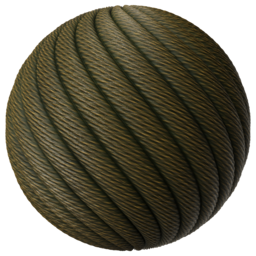</a> <b><a href="Rope003">Rope 003</a></b> by ambientCG · <a href="https://ambientcg.com/a/Rope003">source</a> | <a href="Rubber001">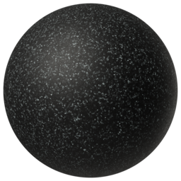</a> <b><a href="Rubber001">Rubber 001</a></b> by ambientCG · <a href="https://ambientcg.com/a/Rubber001">source</a> |
| <a href="Rubber002">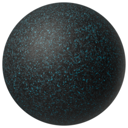</a> <b><a href="Rubber002">Rubber 002</a></b> by ambientCG · <a href="https://ambientcg.com/a/Rubber002">source</a> | <a href="Rubber003">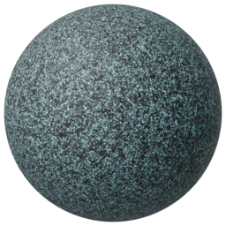</a> <b><a href="Rubber003">Rubber 003</a></b> by ambientCG · <a href="https://ambientcg.com/a/Rubber003">source</a> | <a href="Rubber004">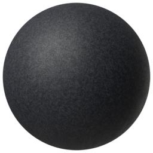</a> <b><a href="Rubber004">Rubber 004</a></b> by ambientCG · <a href="https://ambientcg.com/a/Rubber004">source</a> | <a href="ScatteredLeaves001">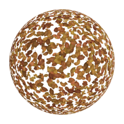</a> <b><a href="ScatteredLeaves001">Scattered Leaves 001</a></b> by ambientCG · <a href="https://ambientcg.com/a/ScatteredLeaves001">source</a> |
| <a href="ScatteredLeaves002">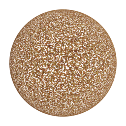</a> <b><a href="ScatteredLeaves002">Scattered Leaves 002</a></b> by ambientCG · <a href="https://ambientcg.com/a/ScatteredLeaves002">source</a> | <a href="ScatteredLeaves003">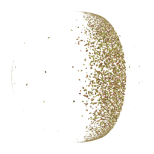</a> <b><a href="ScatteredLeaves003">Scattered Leaves 003</a></b> by ambientCG · <a href="https://ambientcg.com/a/ScatteredLeaves003">source</a> | <a href="ScatteredLeaves004">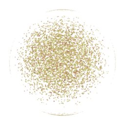</a> <b><a href="ScatteredLeaves004">Scattered Leaves 004</a></b> by ambientCG · <a href="https://ambientcg.com/a/ScatteredLeaves004">source</a> | <a href="ScatteredLeaves005">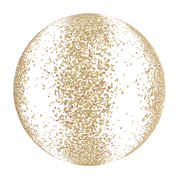</a> <b><a href="ScatteredLeaves005">Scattered Leaves 005</a></b> by ambientCG · <a href="https://ambientcg.com/a/ScatteredLeaves005">source</a> |
| <a href="ScatteredLeaves006">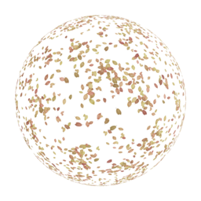</a> <b><a href="ScatteredLeaves006">Scattered Leaves 006</a></b> by ambientCG · <a href="https://ambientcg.com/a/ScatteredLeaves006">source</a> | <a href="ScatteredLeaves007">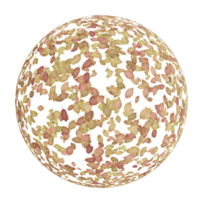</a> <b><a href="ScatteredLeaves007">Scattered Leaves 007</a></b> by ambientCG · <a href="https://ambientcg.com/a/ScatteredLeaves007">source</a> | <a href="ScatteredLeaves008">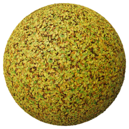</a> <b><a href="ScatteredLeaves008">Scattered Leaves 008</a></b> by ambientCG · <a href="https://ambientcg.com/a/ScatteredLeaves008">source</a> | <a href="ScatteredLeaves009">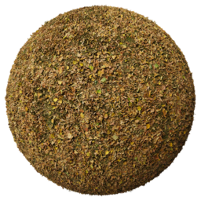</a> <b><a href="ScatteredLeaves009">Scattered Leaves 009</a></b> by ambientCG · <a href="https://ambientcg.com/a/ScatteredLeaves009">source</a> |
| <a href="Scratches001">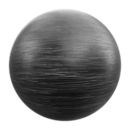</a> <b><a href="Scratches001">Scratches 001</a></b> by ambientCG · <a href="https://ambientcg.com/a/Scratches001">source</a> |  <b><a href="Scratches002">Scratches 002</a></b> by ambientCG · <a href="https://ambientcg.com/a/Scratches002">source</a> | <a href="Scratches003">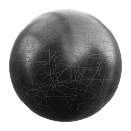</a> <b><a href="Scratches003">Scratches 003</a></b> by ambientCG · <a href="https://ambientcg.com/a/Scratches003">source</a> | <a href="Scratches004">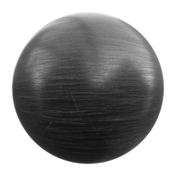</a> <b><a href="Scratches004">Scratches 004</a></b> by ambientCG · <a href="https://ambientcg.com/a/Scratches004">source</a> |
|  <b><a href="Scratches005">Scratches 005</a></b> by ambientCG · <a href="https://ambientcg.com/a/Scratches005">source</a> | <a href="SheetMetal001">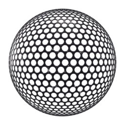</a> <b><a href="SheetMetal001">Sheet Metal 001</a></b> by ambientCG · <a href="https://ambientcg.com/a/SheetMetal001">source</a> | <a href="SheetMetal002">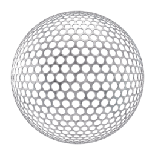</a> <b><a href="SheetMetal002">Sheet Metal 002</a></b> by ambientCG · <a href="https://ambientcg.com/a/SheetMetal002">source</a> |  |

---

Kept up to date by this repository's own [update workflow](.github/workflows/update.yml), with code and plan from [cc0-mirror](https://github.com/zuujis-cc0/cc0-mirror). Something wrong? [Open an issue there](https://github.com/zuujis-cc0/cc0-mirror/issues/new) or use the [private report form](https://games.zuujis.com/report).
